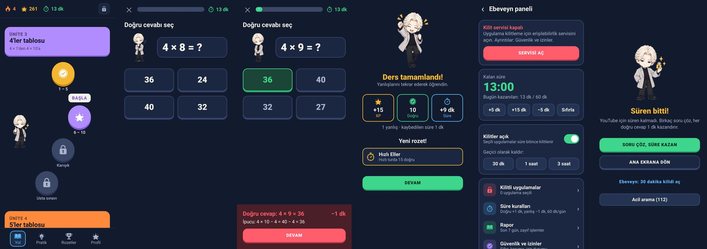

# Çarpım Tablosu

Duolingo tarzında çarpım tablosu eğitimi yapan, **her doğru cevapla telefonda oyun süresi kazandıran** Android uygulaması. 11–12 yaş için tasarlandı. Sunucu, hesap ve veritabanı yoktur; tüm veriler telefonda saklanır.



## İndirme

Her push'tan sonra GitHub Actions APK'yı derleyip **Releases** sayfasına koyar. En son sürümün sabit linki:

```
https://github.com/Waifuhtr/Carpim-tablosu/releases/latest/download/CarpimTablosu.apk
```

Telefonda linki açın, indirilen dosyaya dokunun. "Bilinmeyen kaynaklardan yükleme" izni istenirse verin. Yeni sürüm eskisinin üstüne kurulur; ilerleme silinmez.

## Nasıl çalışır?

| Olay | Süreye etkisi (varsayılan) |
|---|---|
| Doğru cevap | **+1 dakika** |
| Yanlış cevap | **−1 dakika** (0'ın altına inmez) |
| Seçili uygulamada geçen süre | Bankadan düşer (ekran kapalıyken düşmez) |
| Süre 0 olunca | Seçili uygulamalar kilitlenir, "Soru çöz, süre kazan" ekranı açılır |

Ebeveyn panelinden bu değerler, günlük kazanma sınırı (varsayılan 60 dk) ve gece modu değiştirilebilir.

## Özellikler

**Öğrenme**
- 2–12 tabloları için Duolingo tarzı yol haritası: her tabloda 4 ders (1–5, 6–10, Karışık, Usta sınavı)
- Bildiği tabloları atlamak için atlama sınavı
- 5 soru türü: seçenekli, yazarak, eksik sayı (`7 × ? = 56`), bölme, doğru/yanlış
- Yanlış yapılan soru ders sonunda tekrar sorulur; yanlıştan sonra ipucu gösterilir
- Aralıklı tekrar (Leitner kutuları): zayıf işlemler daha sık gelir
- 60 saniyelik hızlı tur, tablo seçerek serbest pratik
- Günlük hedef, seri (🔥), XP, 15 rozet, son 7 gün grafiği, tablo ustalığı
- Soruları sesli okuma, mikrofonla sesli cevap ("kırk iki" → 42), ses efekti ve titreşim

**Kilit ve ebeveyn**
- Harf ve rakamdan oluşan ebeveyn şifresi (PBKDF2 ile özetlenir, düz metin saklanmaz) ve kurtarma kodu
- Hatalı denemelerde artan bekleme süresi
- Kilitlenecek uygulamaları seçme; telefon, ayarlar ve bu uygulama hiçbir zaman kilitlenmez
- Ebeveyn: kilitleri kapatma, 30 dk / 1 saat / 3 saat geçici kaldırma, elle süre ekleme
- Gece modu: belirlenen saatlerde süre olsa bile kilit
- Ayar koruması: Ayarlar'da bu uygulamanın sayfası (erişilebilirlik, uygulama bilgisi, kaldırma) açılınca şifre istenir
- Kaldırma koruması (cihaz yöneticisi)
- 1 dakika kala bildirim, kalan süre bildirimi
- Rapor: günlük doğru/yanlış, kazanılan/kullanılan süre, en çok zorlanılan işlemler
- İlerlemeyi dosyaya yedekleme ve geri yükleme
- Kilit ekranında her zaman "Acil arama (112)" düğmesi

## İlk kurulum (ebeveyn)

1. Uygulamayı açın, çocuğun adını yazın.
2. Ebeveyn şifresini belirleyin. **Kurtarma kodunu kağıda yazın**; sunucu olmadığı için şifre başka yolla sıfırlanamaz.
3. **Erişilebilirlik servisini** açın: Ayarlar → Erişilebilirlik → Yüklü uygulamalar → Çarpım Tablosu → Aç.
   - Android 13 ve üzeri: Servis gri görünüyorsa önce *Uygulama bilgisi → sağ üstteki ⋮ → "Kısıtlanmış ayarlara izin ver"* seçeneğine dokunun. Bu, Play Store dışından yüklenen uygulamalar için Android'in bir güvenlik önlemidir.
4. Bildirim iznini verin. Xiaomi, Huawei, Oppo gibi telefonlarda pil optimizasyonunu "Kısıtlama yok" yapın.
5. Kilitlenecek uygulamaları seçin (YouTube, oyunlar vb.).
6. İsterseniz Ebeveyn paneli → Güvenlik ve izinler → **Kaldırma korumasını aç**.

## Bilinen sınırlar

- Kilit, Android'in erişilebilirlik servisiyle çalışır. Telefonu güvenli modda başlatmak üçüncü taraf servisleri kapatır. Bu, hiçbir normal uygulamanın engelleyemeyeceği bir Android davranışıdır.
- Ayar koruması, Ayarlar'da uygulamanın adının geçtiği her sayfada şifre ister (örneğin tüm uygulamalar listesi).
- Telefonun saati elle ileri alınırsa günlük sayaçlar (seri, günlük sınır) etkilenebilir. Kullanım süresi ise saatten bağımsız ölçülür.
- Sesli cevap için telefonda Google ses tanıma (genelde internet) gerekir. Yoksa mikrofon tuşu görünmez.

## Geliştirme

- Kotlin, Jetpack Compose, minSdk 26 (Android 8.0), targetSdk 35
- Derleme: `./gradlew assembleRelease` → `app/build/outputs/apk/release/app-release.apk`
- Testler: `./gradlew testDebugUnitTest` (mantık katmanı ve Robolectric ile kayıt/akış testleri)
- Ekran görüntüleri: `./gradlew testDebugUnitTest -Pshots` → `screenshots/`
- CI: `.github/workflows/android.yml` (test → lint → APK → Release)

### İmza anahtarı

Güncellemelerin eskisinin üstüne kurulabilmesi için her derleme aynı anahtarla imzalanmalıdır. Varsayılan olarak depodaki `app/debug.keystore` kullanılır. Kendi anahtarınızı kullanmak isterseniz şu GitHub Secrets'ları ekleyin: `RELEASE_KEYSTORE_BASE64`, `RELEASE_KEYSTORE_PASSWORD`, `RELEASE_KEY_ALIAS`, `RELEASE_KEY_PASSWORD`. Anahtar değişirse telefondaki eski sürüm önce kaldırılmalıdır.

### Kod yapısı

```
app/src/main/java/com/carpimtablosu/app/
  logic/   saf Kotlin kuralları (süre bankası, kilit kararı, dersler, aralıklı tekrar, şifre, sesli sayı)
  data/    modeller ve telefonda saklama (SharedPreferences + JSON)
  lock/    erişilebilirlik servisi, kilit ekranı, sistem izinleri
  ui/      Compose ekranları ve tema
```
